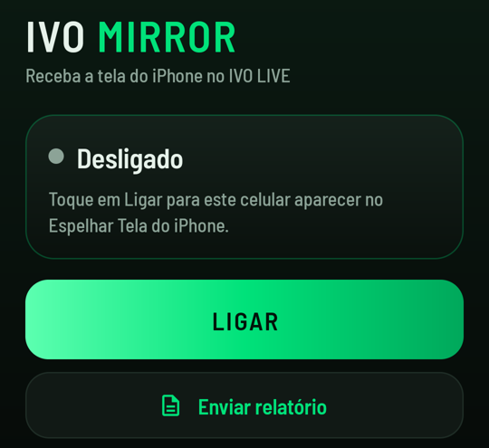
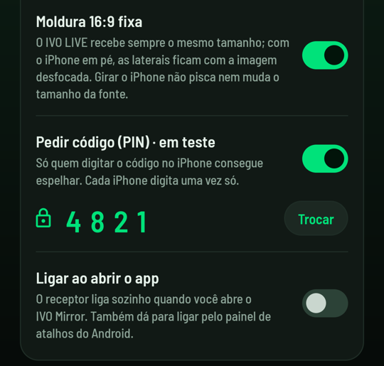

# IVO Mirror

Receba a tela do iPhone num celular Android e use como fonte no **[IVO LIVE](https://evilgreenivo.github.io/ivo-live/)**, o estúdio de live e gravação grátis para Android.

No iPhone você usa o **Espelhar Tela** de sempre (Central de Controle). O IVO Mirror recebe a imagem e o som e manda para o IVO LIVE, no mesmo celular ou em outro da mesma Wi-Fi, como a fonte **Outro celular**.

<p align="center">
  
  &nbsp;
  
</p>

## Baixar

Baixe o APK mais novo em **[Releases](https://github.com/evilgreenIvo/ivo-mirror/releases/latest)** e instale no celular Android (Android 10 ou mais novo, processador de 64 bits).

## Como usar

1. Deixe o iPhone e o celular Android na mesma Wi-Fi.
2. Abra o IVO Mirror e toque em **Ligar**.
3. No iPhone, abra a Central de Controle, toque em **Espelhar Tela** e escolha **IVO Mirror (nome do celular)**.
4. No IVO LIVE: **+ Fonte › Outro celular › "iPhone · …"**.

Também dá para ligar e desligar pelo botão **IVO Mirror** no painel de atalhos do Android, sem abrir o app.

Se algo der errado, toque em **Enviar relatório**: sai um arquivo .txt só com o que importa para achar o problema.

## Ajustes

- **Qualidade Normal ou Alta.** Normal (1080p) é leve. Alta (1440p) deixa a imagem do iPhone em pé com cerca do dobro da nitidez, mas pesa mais no celular Android.
- **Moldura 16:9 fixa** (ligada de fábrica). O IVO LIVE recebe sempre o mesmo tamanho. Com o iPhone em pé, as laterais mostram a própria imagem desfocada, e girar o iPhone não pisca nem muda o tamanho da fonte.
- **Pedir código (PIN)**, em teste. Só quem digitar o código de 4 números no iPhone consegue espelhar; cada iPhone digita uma vez só.
- **Ligar ao abrir o app.**
- **Português, inglês e espanhol**, escolhidos pelo idioma do celular (no Android 13 ou mais novo dá para escolher só para o IVO Mirror nas configurações do Android).
- **Aviso de versão nova:** o app olha aqui no GitHub e mostra quando sair uma versão mais nova.

## O que dá e o que não dá

- **Cerca de 30 quadros por segundo.** É o limite do espelhamento do iPhone. O app já pede 60, e o iPhone responde com 30.
- **Apps protegidos aparecem pretos** (Netflix, Disney+, Apple TV+, Prime Video). É proteção contra cópia feita pelo próprio iPhone.
- **Só o som do sistema.** O espelhamento não manda o microfone do iPhone.
- **Não controla o iPhone** pelo Android.

## Compilar

Projeto Android (Kotlin + C via NDK, só `arm64-v8a`). Precisa do Android SDK, do NDK e do Gradle. A parte nativa já vem com o UxPlay, a libplist e a `libcrypto.a` do OpenSSL compilada para Android 29 em `app/src/main/cpp`.

```
gradle assembleDebug
```

Sem a chave de assinatura (que não fica no repositório), `assembleRelease` gera um APK sem assinatura.

## Licença

Código aberto sob a **GPL-3.0-or-later** (arquivo [LICENSE](LICENSE)). As partes de terceiros e suas licenças estão em [NOTICE.md](NOTICE.md).

iPhone, iOS e AirPlay são marcas da Apple Inc. Este projeto não é da Apple nem tem ligação com ela.
